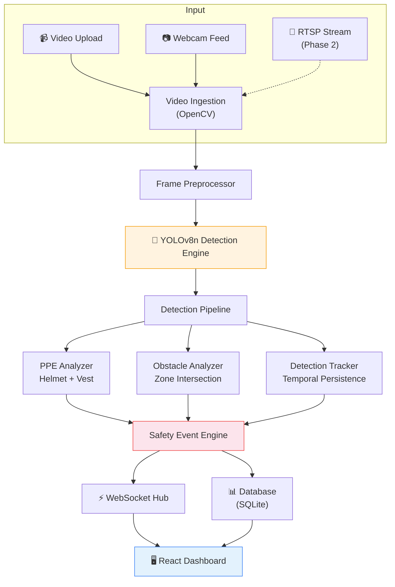

# 🛡️ Smart Workplace Safety Intelligence Platform

**AI-Powered Real-Time Workplace Safety Monitoring System**

An advanced computer vision platform that leverages deep learning (YOLOv8) to monitor workplace environments in real-time, detect Personal Protective Equipment (PPE) compliance, identify potential obstacles and hazards, and generate safety events — all through an intuitive, professional dashboard.

> **Current Status: Phase 1 Complete (~40% of planned functionality)**
> Core video monitoring, PPE detection, obstacle detection, and safety zone management are fully operational.

---

## 🏗️ Architecture



---

## ✨ Features (Phase 1)

| Feature | Status | Description |
|---------|--------|-------------|
| **Real-Time Video Processing** | ✅ | Upload videos or connect webcam for live processing |
| **YOLO Object Detection** | ✅ | YOLOv8n for fast, accurate object detection |
| **Worker Detection** | ✅ | Detect and count workers in video frames |
| **PPE Detection** | ✅ | Identify helmets and safety vests |
| **PPE Compliance Analysis** | ✅ | Per-worker compliance status (Compliant / Helmet Missing / Vest Missing / Violation) |
| **Safety Zone Management** | ✅ | Draw rectangular zones on canvas, configure thresholds |
| **Obstacle Detection** | ✅ | Detect objects in safety zones with temporal persistence |
| **Real-Time Dashboard** | ✅ | WebSocket-driven live monitoring with bounding boxes |
| **Event Detection & Logging** | ✅ | Automatic event creation with snapshot capture |
| **Performance Monitoring** | ✅ | Real FPS, inference latency, worker count |
| **GPU Acceleration** | ✅ | Auto-detects CUDA GPU, falls back to CPU |

---

## 🛠️ Technology Stack

| Layer | Technology |
|-------|-----------|
| **AI / Detection** | Python, Ultralytics YOLOv8, OpenCV, PyTorch |
| **Backend** | FastAPI, SQLAlchemy 2.0, Pydantic v2, WebSockets |
| **Frontend** | React 18, TypeScript, Vite, Tailwind CSS |
| **Database** | SQLite (PostgreSQL-ready via SQLAlchemy) |
| **Geometry** | Shapely (zone intersection calculations) |
| **Deployment** | Docker, Docker Compose |

---

## 📋 Prerequisites

- **Python** 3.11+
- **Node.js** 20+
- **Git**
- **(Optional)** NVIDIA GPU with CUDA for accelerated inference
- **(Optional)** Docker & Docker Compose

---

## 🚀 Quick Start

### 1. Clone & Setup

```bash
git clone <repository-url>
cd workplace-safety

# Copy environment config
cp .env.example .env
```

### 2. Backend Setup

```bash
# Create virtual environment
python -m venv venv
# Windows
venv\Scripts\activate
# Linux/Mac
source venv/bin/activate

# Install dependencies
pip install -r backend/requirements.txt

# Download YOLOv8n model (auto-downloads on first run)
python scripts/download_model.py
```

### 3. Frontend Setup

```bash
cd frontend
npm install
cd ..
```

### 4. Run the Application

**Terminal 1 — Backend:**
```bash
cd backend
uvicorn app.main:app --reload --host 0.0.0.0 --port 8000
```

**Terminal 2 — Frontend:**
```bash
cd frontend
npm run dev
```

**Open:** [http://localhost:3000](http://localhost:3000)

### Docker Setup (Alternative)

```bash
cd docker
docker-compose up --build
```

Access at [http://localhost:3000](http://localhost:3000)

---

## 📖 How to Use

### Upload a Video
1. Navigate to **Cameras** page
2. Click **Upload Video** → select an `.mp4` file
3. Navigate to **Live Monitoring**
4. Select **Video File** mode → click **Start Detection**

### Use Webcam
1. Navigate to **Live Monitoring**
2. Select **Webcam** mode → click **Start Detection**
3. Detection starts immediately on default camera (index 0)

### Create a Safety Zone
1. Navigate to **Safety Zones**
2. Click **Create Zone**
3. Draw a rectangle on the canvas (click and drag)
4. Configure: name, type, overlap threshold, persistence frames
5. Click **Save Zone**
6. Zones are automatically used during detection

### Monitor Safety Events
1. Events are automatically created when:
   - A worker is detected without PPE (helmet/vest)
   - An object persists inside a safety zone
2. View events on **Events** page or in the monitoring sidebar
3. Events include timestamps, severity, and snapshot images

---

## 🔌 API Reference

| Method | Endpoint | Description |
|--------|----------|-------------|
| `GET` | `/api/health` | System health check |
| `POST` | `/api/video/upload` | Upload video file |
| `POST` | `/api/detection/start` | Start detection on source |
| `POST` | `/api/detection/stop` | Stop detection |
| `GET` | `/api/detection/status` | Current detection status |
| `GET` | `/api/events` | List safety events (filterable) |
| `GET` | `/api/events/{id}` | Get event details |
| `GET` | `/api/events/stats/summary` | Event statistics |
| `GET` | `/api/zones` | List safety zones |
| `POST` | `/api/zones` | Create safety zone |
| `PUT` | `/api/zones/{id}` | Update zone |
| `DELETE` | `/api/zones/{id}` | Delete zone |
| `GET` | `/api/cameras` | List cameras/sources |
| `POST` | `/api/cameras` | Add camera |
| `GET` | `/api/settings` | System settings |
| `GET` | `/api/settings/system-status` | System status |
| `WS` | `/ws/detection` | Real-time detection stream |

Full API docs available at: [http://localhost:8000/docs](http://localhost:8000/docs) (Swagger UI)

---

## 🧠 How Detection Works

### PPE Detection

```
1. YOLO detects all objects in frame
2. Filter for "person" detections
3. Filter for "helmet" and "safety-vest" detections
4. For each worker: find nearby PPE items using bounding box IoU/proximity
5. Determine compliance status:
   - Helmet ✅ + Vest ✅ → COMPLIANT
   - Helmet ❌ + Vest ✅ → HELMET MISSING
   - Helmet ✅ + Vest ❌ → VEST MISSING  
   - Helmet ❌ + Vest ❌ → VIOLATION
```

> **Note:** The base YOLOv8n model (COCO) detects persons but doesn't include helmet/vest classes. For full PPE detection, a fine-tuned model on a PPE dataset is needed. The training pipeline is included in `ml/training/`.

### Obstacle Detection

```
1. YOLO detects all objects (excluding persons and PPE items)
2. For each non-person object:
   a. Compute bounding box intersection with each active safety zone
   b. Calculate overlap ratio using Shapely geometry
   c. If overlap ≥ threshold → potential obstacle
3. Temporal persistence:
   a. Track object across consecutive frames
   b. Only generate event if object persists for N frames
   c. Event cooldown prevents duplicate alerts
```

### Safety Zone Logic

```
Zone (normalized polygon) × Frame dimensions → Scaled polygon
Object bbox → Shapely box
Intersection area / Object area = Overlap ratio
If overlap ≥ threshold AND persistence ≥ N frames → OBSTACLE EVENT
```

---

## 📊 Model Information

| Property | Value |
|----------|-------|
| **Model** | YOLOv8n (Ultralytics) |
| **Base Training** | COCO dataset (80 classes) |
| **Input Size** | 640 × 640 |
| **Architecture** | CSPDarknet backbone |
| **Parameters** | ~3.2M |
| **Inference** | ~15-45 FPS (CPU) / ~60-120 FPS (GPU) |

### Training Your Own Model

```bash
cd ml/training
python train.py --data path/to/data.yaml --model yolov8n.pt --epochs 100
```

See `ml/datasets/README.md` for dataset preparation instructions.

### Evaluation

```bash
cd ml/evaluation
python evaluate.py --model path/to/best.pt --data path/to/data.yaml
```

> **Important:** Model performance metrics are only reported after actual evaluation. No metrics are fabricated.

---

## ⚙️ Environment Variables

| Variable | Default | Description |
|----------|---------|-------------|
| `DATABASE_URL` | `sqlite+aiosqlite:///./safety_intelligence.db` | Database connection |
| `MODEL_PATH` | `yolov8n.pt` | Path to YOLO model weights |
| `MODEL_CONFIDENCE_THRESHOLD` | `0.5` | Minimum detection confidence |
| `MODEL_DEVICE` | `auto` | Device: `auto`, `cuda`, `cpu` |
| `PPE_CONFIDENCE_THRESHOLD` | `0.45` | PPE detection threshold |
| `OBSTACLE_PERSISTENCE_FRAMES` | `10` | Frames before obstacle alert |
| `OBSTACLE_ZONE_OVERLAP_THRESHOLD` | `0.3` | Zone overlap ratio |
| `EVENT_COOLDOWN_SECONDS` | `30` | Cooldown between duplicate events |
| `VIDEO_FPS_LIMIT` | `30` | Max processing FPS |
| `WS_FRAME_QUALITY` | `70` | WebSocket JPEG quality (0-100) |

---

## 📂 Project Structure

```
workplace-safety/
├── backend/                    # FastAPI backend
│   ├── app/
│   │   ├── api/routes/         # REST API endpoints
│   │   ├── core/               # Logging, security
│   │   ├── database/           # SQLAlchemy session, init
│   │   ├── detection/          # YOLO engine, PPE analyzer, obstacle analyzer, tracker
│   │   ├── models/             # Database models
│   │   ├── schemas/            # Pydantic schemas
│   │   ├── services/           # Business logic (detection, events, zones)
│   │   └── video/              # Video processing, frame utilities
│   └── requirements.txt
├── frontend/                   # React + TypeScript frontend
│   ├── src/
│   │   ├── components/         # UI components (layout, monitoring, dashboard, zones)
│   │   ├── hooks/              # React hooks (WebSocket, API)
│   │   ├── pages/              # Page components (6 pages)
│   │   ├── services/           # API client
│   │   ├── types/              # TypeScript interfaces
│   │   └── utils/              # Formatting utilities
│   └── package.json
├── ml/                         # Machine learning pipeline
│   ├── datasets/               # Dataset documentation
│   ├── training/               # Training scripts + config
│   ├── evaluation/             # Model evaluation
│   ├── inference/              # Benchmarking
│   └── models/                 # Model weights (.gitignored)
├── docker/                     # Docker configuration
├── docs/                       # Documentation
├── configs/                    # Default configuration
├── scripts/                    # Setup and utility scripts
├── tests/                      # Test suites
├── .env.example                # Environment template
└── README.md
```

---

## 📊 Current Implementation: 40%

### ✅ Implemented (Phase 1)
- Video input (upload + webcam)
- Frame preprocessing
- YOLOv8 detection engine
- Worker detection
- Initial PPE detection pipeline
- PPE compliance logic (4 states)
- Safety zone drawing + configuration
- Obstacle detection with zone intersection
- Temporal persistence tracking
- Event generation + deduplication
- Event storage with snapshots
- Real-time WebSocket dashboard
- Performance metrics (real FPS/latency)
- 6-page professional UI

### 🔮 Planned (Remaining 60%)

| Phase | Features |
|-------|----------|
| **Phase 2** | Advanced PPE (gloves, goggles, masks), fall detection via pose estimation, unsafe behavior detection, restricted area monitoring |
| **Phase 3** | IoT sensor integration (gas, smoke, temperature), sensor fusion |
| **Phase 4** | Advanced analytics, compliance reports, historical trends, predictive safety |
| **Phase 5** | Face anonymization, RBAC authentication, multi-camera management, multi-site deployment, TensorRT optimization |

---

## ⚠️ Known Limitations

1. **PPE Classes**: Base COCO model detects persons but not helmets/vests specifically. Fine-tuning on a PPE dataset is required for accurate PPE detection.
2. **Obstacle Types**: Limited to COCO object classes. Custom training needed for specific industrial objects.
3. **Single Stream**: Currently processes one video source at a time. Multi-camera is architecturally supported but not implemented.
4. **Settings**: Configuration changes require `.env` file edit and restart. Live settings UI is Phase 2.
5. **No Authentication**: No user login or role-based access control (Phase 5).
6. **CPU Performance**: On CPU-only machines, expect 5-15 FPS. GPU recommended for real-time performance.

---

## 🎓 Academic Documentation

Every feature in this system can be explained through:

| Aspect | Description |
|--------|-------------|
| **WHAT** | What the feature does |
| **WHY** | Why it's needed for workplace safety |
| **HOW** | Technical method used (YOLO, IoU, Shapely, WebSocket, etc.) |
| **INPUT** | Data the feature receives |
| **OUTPUT** | What it produces |
| **LIMITATION** | Current constraints |
| **FUTURE** | Planned improvements in remaining phases |

Detailed methodology documents available in `docs/`:
- [Architecture](docs/architecture.md)
- [PPE Detection Methodology](docs/ppe_detection.md)
- [Obstacle Detection Methodology](docs/obstacle_detection.md)
- [API Documentation](docs/api.md)
- [Future Roadmap](docs/roadmap.md)

---

## 📜 License

MIT License — see [LICENSE](LICENSE) for details.

## 🙏 Acknowledgments

- [Ultralytics](https://ultralytics.com/) for YOLOv8
- [FastAPI](https://fastapi.tiangolo.com/) framework
- [Tailwind CSS](https://tailwindcss.com/) for styling
- Open-source PPE detection datasets from the research community
