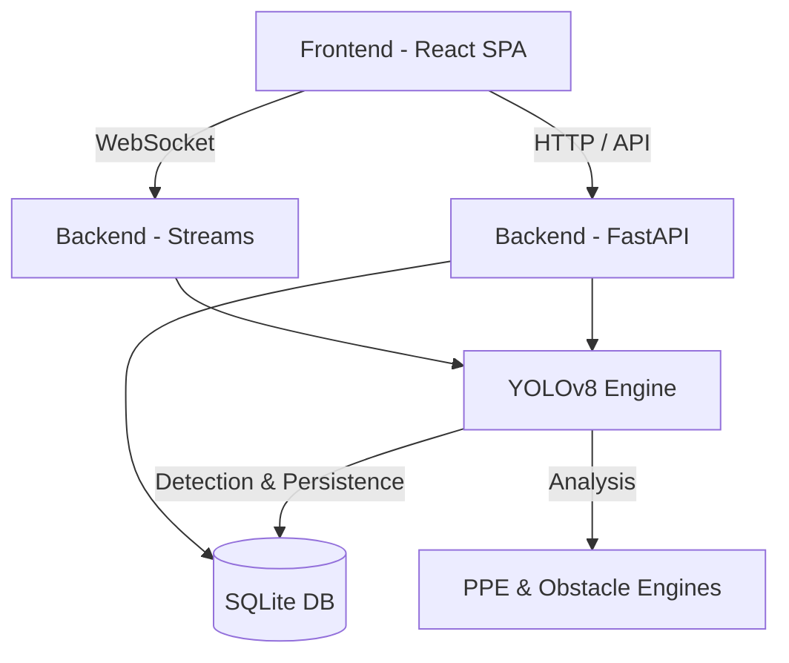

# Architecture Overview

## System Overview Diagram
The system architecture consists of a unified containerized setup serving ML-based video inference alongside a modern UI.

## Component Descriptions
- **Frontend**: A React-based Single Page Application.
- **Backend**: FastAPI for async endpoint handling. WebSocket support for live streaming video feeds.
- **ML Engine**: Ultralytics YOLOv8 customized for real-time edge processing.
- **Data Persistence**: SQLite utilized for storing configuration, zones, and past alert events.

## Data Flow
1. User uploads video or connects IP stream via Frontend.
2. Backend API routes feed to ML inference engine.
3. Model extracts objects; Analytics engines evaluate compliance (PPE) and zoning (Obstacles).
4. Frame is overlaid with alert boxes and dispatched via WebSocket back to the UI.

## Phase 1 vs Future Phases
Phase 1 focuses exclusively on static video analysis and webcam support for PPE and basic obstacle detection.
Future phases will integrate IoT sensor pipelines and predictive analytics modules.
